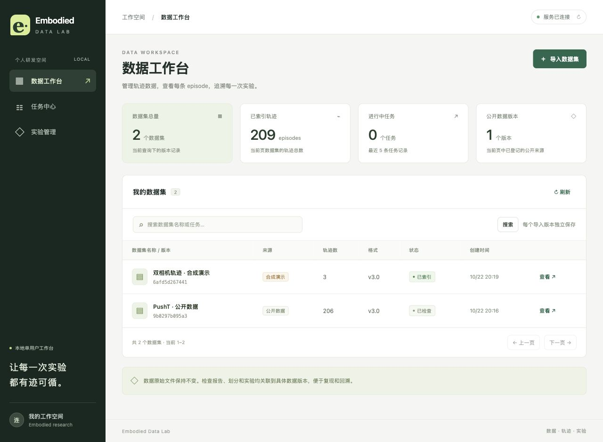
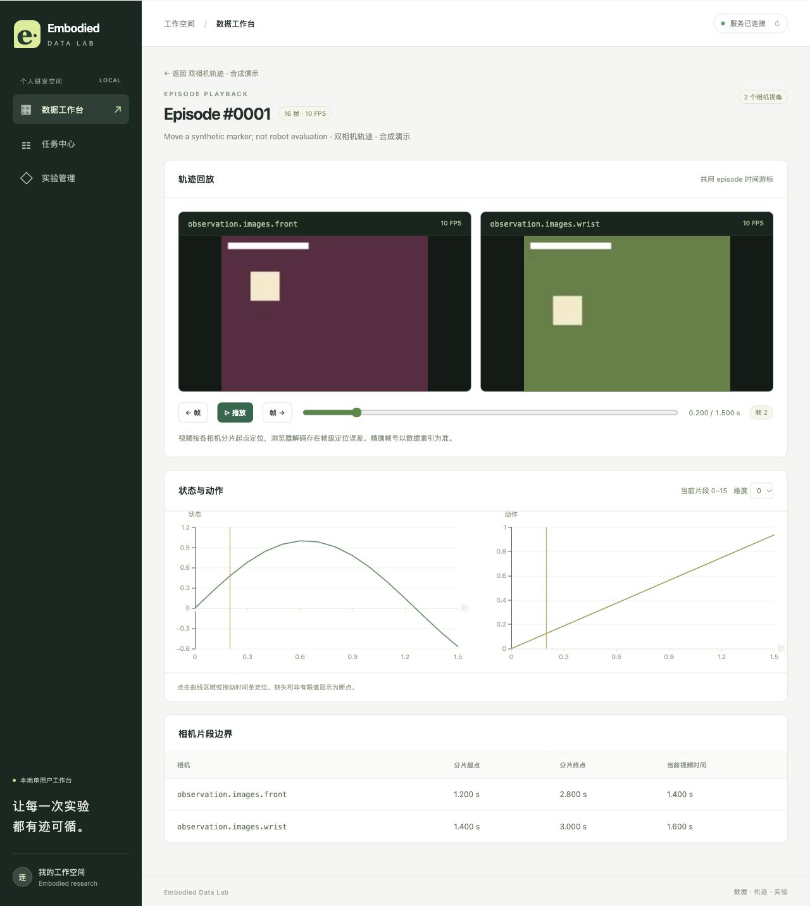

# 实际验收记录

2026-10-22，Asia/Shanghai。Apple Silicon Mac、Python3.12.15、Node24.19.0、pnpm11.25.0、真实PostgreSQL16.15；没有SQLite替身、网络mock或随机成功任务。

## 最终命令和结果

根目录：

```text
.venv/bin/ruff check backend tests scripts
All checks passed!

.venv/bin/pytest -q
.................................. [100%]
34 passed in 19.96s
```

前端目录：

```text
pnpm test
Test Files 1 passed / Tests 4 passed

pnpm build
vue-tsc -b && vite build 通过
按需加载页面，最大JS chunk约336.06 KB
```

最终后端没有skipped。未来缺少PG或公开样本会明确skip，不可把skip算通过。

| 测试 | 数量 | 真实行为 |
| --- | --- | --- |
| `test_adapter.py` | 20 | 共享分片、双相机offset、分页局部时间/非零origin、缺字段/NaN/Inf/维度/时间/索引/路径、实际时间越视频片段和半帧容差、统计、划分、公共首末解码 |
| `test_api_integration.py` | 8 | 干净PG迁移、HTTP/worker导入、API重启持久化、幂等、媒体Range206、路径、SSE游标、结果schema/来源/比较、大小/NaN错误、新版本隔离、产物篡改/缺失/非法JSON |
| `test_worker_reliability.py` | 5 | 真PG行锁和双worker、SIGKILL租约恢复、运行中取消、坏数据失败重试、**质量任务执行期间API重启后同一attempt继续完成并补查日志** |
| `test_worker_publication.py` | 1 | 真实快照复制/索引/rename后注入报告写失败，核查普通失败无DB引用/孤立快照、原文件保留 |
| 前端timeline行为测试 | 4 | 独立相机映射、exclusive末帧/单帧、真实时间定位、日志去重排序 |

集成测试创建随机 `embodied_api_test_*` 库和临时storage，运行真实迁移、uvicorn和worker，结束后删除自己的测试库，不清空工作台。报告写失败是明确故障注入，其余IO和数据库操作真实执行，没有宣称实际磁盘已损坏。

## 完整停止、重启与最新CPU运行

实际执行 `bash scripts/stop.sh`：API/前端不可连接、PG55432 no response。再执行 `bash scripts/dev.sh`：API/前端200、worker health退出0。2个Dataset的ID/指纹、2个Experiment ID和4条历史Job完全保留。当前服务已启动。

重启后新建公开质量任务：

- Job：`810c0439-fcea-4271-8b20-56713917e722`，succeeded、attempt1。
- Dataset：`16a6012e-32ad-439b-9cb6-1b0491f21e0b`。
- 适配器：`eld-lerobot-v3-2`，格式依据LeRobot v0.4.3。
- 实际检查206episode、25,650帧、0errors/0warnings。
- JSON Artifact：`c8fad8fc-f96f-43ac-953f-ae786bdda943`。
- 实际下载SHA256：`64082e3e56880450386a70625d79e41ea17b5cbba5ea63214e3fa2a53371bb97`，与DB一致。

机器可读证据：[final_runtime_evidence.json](final_runtime_evidence.json)。最新v2完整报告：[public_quality_evidence.json](public_quality_evidence.json)。0error只表示未触发已实现规则，不表示排除所有可能数据问题。

## 数据与来源

完整公开PushT：repo `lerobot/pusht`，revision `7628202a2180972f291ba1bc6723834921e72c19`，7,684,382字节，206episode/25,650帧共享Parquet与AV1 MP4。逐文件URL/大小/SHA在 `storage/incoming/public-small/SOURCE.json`。内容指纹 `9b0297b095a3413db79b882e7f3b19625357304c1a39f20d833bc7b349dbd561`。

合成样本3episode共享Parquet，两路H264 MP4分别有独立偏移，wrist多0.2秒前导。合成标记保留，未冒充真机采集。对合成数据实际计算的报告是executed，并注明data_source_kind=synthetic_demo。

## 浏览器实际流程

实际操作了：公开/合成导入、schema、公开视频与双相机回放、拖动/按帧/切维度、质量任务、JSON/CSV下载、刷新日志恢复、episode划分、检查点登记、实验创建、结果粘贴和文件选择导入、同条件/不同seed比较、未配置runner禁用。完整重启后复查数据与页面。

- 公开episode1帧117：局部11.7秒，video.currentTime27.8，小于exclusive结束27.9，无video.error。
- 双相机episode1同一0.2秒游标：front1.4/wrist1.6，两个readyState4、error=null。
- 实际公开划分ratio0.8/seed42：164训练/42验证；重复性与无交叉由行为测试验证。
- A/B人工trial计数50%/100%只验证归档和比较，均synthetic_demo，**不是模型成绩**；不同seed明确不可直接比较。

具体操作、ID和11张截图见 [BROWSER_ACCEPTANCE.md](BROWSER_ACCEPTANCE.md)。





## 开发中修复的边界

1. NaN导致默认错误响应再次序列化失败：入口拒绝非标准JSON返回400；合法JSON的schema错误返回422。
2. 名义fps会掩盖真实timestamp越视频：v2按实际时间映射，越界error且回放拒绝，半帧边界有回归。
3. 浏览器seek到exclusive结尾会跨episode：限定最后有效帧，含单帧测试与公开末帧实测。
4. SSE先读事件再读状态存在提交竞态：先读终态，再取已提交事件，排空再结束。
5. snapshot移出staging后runner return前异常清理遗漏：提前登记归属，finally查DB引用补偿；真实IO故障注入回归通过。
6. report与下载完整性不一致：报告/下载/比较统一校验，损坏或缺失报告不作为原结果展示。

## 未验证及限制

- Docker未安装：Compose/Dockerfile仅静态检查与镜像标签确认，没有容器构建/运行声明。
- 未下载权重、未运行SmolVLA训练/LIBERO仿真/机器人；训练接入只有参数、能力检查和受控命令构建，默认未配置。
- 没有安装官方完整LeRobot reader，轻量适配器只验证明确格式子集；详见DATA_FORMAT。
- 没有证明所有设备逐帧精确、硬实时或生产并发吞吐。
- DB/磁盘非原子事务，SIGKILL可能遗留未登记孤立文件，目前无自动GC；普通失败/合作式取消补偿已验证。
