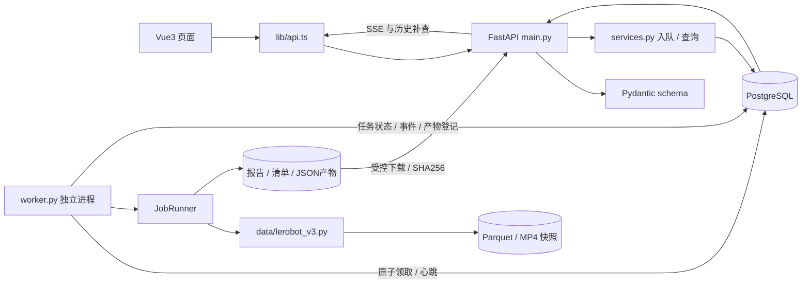
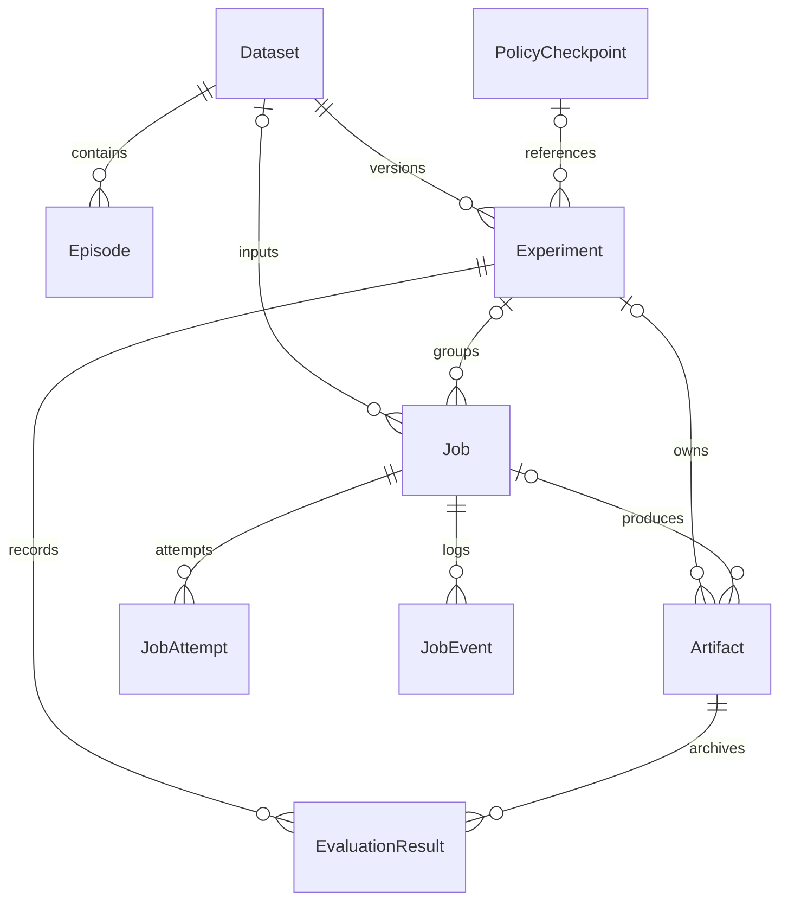
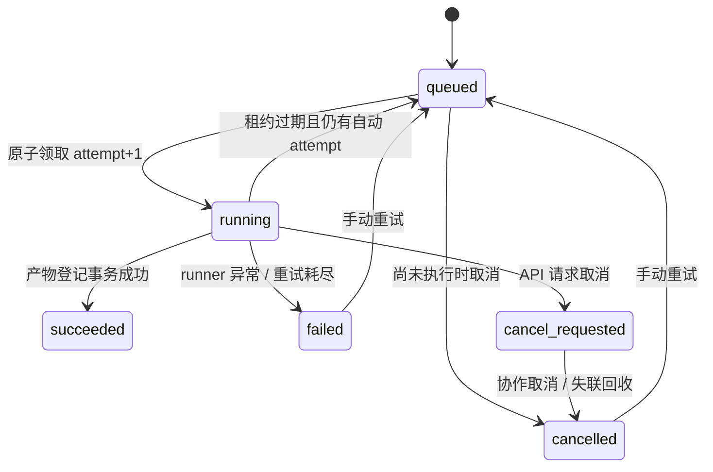

# 架构与关键取舍

范围是本地单用户研究工作台。业务元信息与任务状态在 PostgreSQL，Parquet/视频/报告在受控文件目录；API 不执行长任务，独立 worker 执行 CPU 数据任务。没有 Redis、Celery、Kubernetes 或训练框架随 Web API 启动。

## 模块与请求路径

| 层 | 实际文件 | 职责 |
| --- | --- | --- |
| 页面与路由 | `frontend/src/main.ts`、`pages/*.vue` | 数据、回放、任务与实验操作 |
| 请求与事件 | `frontend/src/lib/api.ts` | 真实 API 请求、错误、SSE 游标 |
| 时间映射 | `frontend/src/lib/timeline.ts`、`pages/EpisodePage.vue` | episode 时间、共享视频起点、帧游标 |
| HTTP 边界 | `backend/app/main.py` | 请求大小/JSON 合法性、HTTP 状态、路由、SSE |
| 数据验证 | `backend/app/schemas.py`、`training.py` | 禁止多余字段、类型和指标范围、受控参数 |
| 事务与模型 | `db.py`、`models.py`、`services.py` | PostgreSQL 会话、外键/唯一约束、幂等入队 |
| 后台调度 | `worker.py` | 租约、attempt、领取、取消、runner、产物发布 |
| 数据适配 | `data/lerobot_v3.py` | v3.0 元信息、共享分片、质量检查、划分、统计 |
| 文件边界 | `storage.py` | 相对路径控制、快照复制、原子 JSON 写入、内容校验 |

## 数据关系

- Dataset 的内容指纹唯一；Episode 的 `(dataset_id, episode_index)` 唯一。历史实验固定引用 Dataset ID，不会被重新导入的数据覆盖。相同内容指纹复用已有数据记录。
- Job 幂等键唯一，另存请求签名；同键同内容返回同一任务，同键不同内容返回 409。数据库唯一约束也处理同时提交时的竞争。
- JobAttempt 为 `(job_id, attempt)` 唯一，保留每次领取者、状态和错误；JobEvent 使用全局递增 bigint ID，按 job_id 和游标索引查询。
- Experiment 保存数据版本、可选检查点、配置、code_version；结果另存 EvaluationResult，原始结构规范化归档到 Artifact。
- 外键统一 RESTRICT，防止删除输入数据后历史实验或报告失去追溯。首版不提供删除业务入口。
- 任务领取索引 `(status, created_at)`，失联回收按 lease_expires_at 索引；episode 以 dataset_id 与序号检索。
- 数据库连接设定 UTC，时间存 timestamptz，HTTP 返回带时区的 ISO 时间。

数据库迁移在 `backend/migrations/versions/75cddb6d3540_initial_immutable_datasets_jobs_events_.py`；启动时执行 `alembic upgrade head`，不靠每次启动自动 create_all 掩盖迁移缺口。

## 一次导入怎样落地

1. `DatasetsPage.vue` 选择 `/api/sources` 提供的受控来源，POST `/api/datasets`。
2. `DatasetImport` 校验名称、相对路径、来源和幂等键；公开来源要求 source_uri 和 revision。
3. 路由先确认路径在 `storage/incoming/`，再调用 `enqueue` 把 import_dataset 任务及首条事件提交到 PostgreSQL，返回 202。
4. `claim_job` 在事务内 `FOR UPDATE SKIP LOCKED` 选择 queued 行，更新 attempt/worker/lease，插入 JobAttempt，提交后才工作。第二个 worker 无法在同一时间领取被锁住的 queued 行。
5. `ImportRunner` 将原文件复制到 attempt 专属 staging，拒绝越界/符号链接/超额文件。解析 v3 metadata，计算内容指纹，将快照移动到该 attempt 的 dataset 目录。
6. `publish` 先移动报告到 attempt 产物目录，然后在加锁事务中再检查 worker_id、attempt、租约和状态；登记 Dataset、Episode、Artifact，最后把任务改为 succeeded。
7. 事件经数据库保存，SSE 传给任务页。页面查询最终任务就能进入 Dataset ID，独立下载产物。

文件系统与数据库不是分布式事务。普通提交失败会回滚数据库并补偿删除已移动产物；快照是否被引用会在 finally 检查。SIGKILL 恰好发生在 rename 和 DB commit 之间时，可能留下未引用目录，但不会被当成成功产物。当前没有自动垃圾回收器，清理前必须核对数据库引用，不能删除仍在执行的 attempt 目录。

## 任务状态、租约和重试

语义是**至少一次**：服务崩溃后可能重新执行，绝不声明 exactly-once。

- 默认租约 15 秒、心跳 3 秒。每个执行中的 JobContext 有独立心跳线程，更新受 worker_id/attempt/有效租约约束的任务行。
- worker 的循环调用 `recover_expired`。过期 attempt 记 interrupted，剩余预算可重新排队；默认 max_attempts=2。没有任何 worker 在线时，不会凭空完成回收；下一 worker 启动后检测。
- 普通数据错误直接 failed，不自动反复处理坏输入；失联恢复受 max_attempts 限制。手动重试明确增加一次可执行机会，历史 attempt 与事件不删除。
- 任务代码在复制分块、处理批次等检查点调用 `ctx.check`；cancel_requested 或 worker 收到 SIGTERM 会协作取消，不承诺随时抢占任何第三方 C 扩展调用。
- 发布前再次持有 Job 行锁验证归属，旧 attempt 即使继续运行也不能在租约失效后发布成功记录；不同 attempt 的文件目录互不覆盖。
- 全局与分片质量进度来自实际扫描/解码数量，没有随机进度或 sleep 假任务。

## SSE 与断线恢复

`GET /api/jobs/{id}/events?after=<cursor>` 补查持久事件；`/stream` 使用 SSE 的 id 与 `event: log`，接收 query 游标及浏览器 Last-Event-ID，取较大者。

SSE 循环每次短暂打开数据库会话，查询后关闭，不持有连接等待浏览器。终态排空历史后发 end 事件。前端按 ID 排序和去重；SSE 只是传输层，断线不会取消 worker。API 重启或页面刷新后，普通任务详情和历史接口仍可恢复最终状态。

## LeRobot 格式和回放

本项目只支持核对过的 **v3.0、MP4 相机、一维 state/action 向量**。适配器核对上游 v0.4.3 源码，但没有安装官方训练 reader；原因是 Web/CPU 平台不需要 torch/datasets/训练 transforms。完整依据及尚未验证的官方 reader 兼容性见 [DATA_FORMAT.md](DATA_FORMAT.md)。

metadata 给出 episode 的全局左闭右开 index 范围、所属 Parquet chunk/file、每路相机 chunk/file 和 from/to timestamp。多条 episode 可共用数据/视频文件；相机可以有不同起点。读取不根据文件名假设“一集一文件”。

Frames API 对当前 episode 做范围过滤和分页，最多返回 2000 帧；视频 URL 指向受控的原共享 MP4，支持浏览器 Range 请求。回放以 episode 局部时间作为游标，每路视频时间等于 `camera.start_time + local_time`。质量检查对原始时间和真实视频 PTS 校验，浏览器 seek 的误差与真实编码关键帧相关，不宣称浏览器绝对逐帧无误差。

训练/验证划分使用完整 episode 列表、独立随机种子和指纹；不切相邻帧。统计采用流式 Welford 累计；质量报告精确计数但限制具体 issues 数量，避免异常大数据导致报告无限增长。

## 结果来源和实验比较

- Dataset.source_kind：local / public / synthetic_demo，是输入数据的来源。
- Artifact.source_kind：executed / imported / synthetic_demo，是该产物如何产生。平台真实计算的合成数据质量报告可以是 executed，同时报告包含 data_source_kind=synthetic_demo。
- 客户端评测文件只接受 imported / synthetic_demo，不能自行提交 executed。没有平台真实模型执行就没有执行成绩。
- EvaluationBundle 限制请求 2MB、任务集合与 trials 一致、success 为严格布尔、steps/latency 有效且有限；服务器从 trials 计算 count、successes 和均值，不信任外填成功率。
- 保存的 JSON 是 schema 验证后内容等价的规范化档案，含默认字段；不保留字节级空白和键顺序。
- 比较最近一次结果时核对数据指纹、每任务样本数、seed、指标定义和来源类型，保留不一致原因；模型与配置仍展示，供研发人员判断变化。

## 文件、参数和运行边界

- `controlled_path` / 适配器 `_path` 要求相对路径，resolve 后仍在批准根目录，拒绝 `..` 与符号链接越界。原数据包不执行代码。
- API 请求限 2MB，小结果文件由前端读取后发 JSON；大数据留在 incoming，首版不实现 ZIP 解压上传，避免另一套解压边界。
- 导入限制默认 1GiB、最多 50,000 文件；每份快照内容指纹在后续数据任务前重新校验。下载 Artifact 与实验比较会检查 SHA256，不悄悄使用被外部修改的归档文件。
- 训练/评测 runner 当前未配置；`training.py` 只提供参数模型、环境说明和 argv 列表构造，API 返回 409。字符串不会拼接成任意 shell 命令，也不通过 Web 表单执行上传脚本。
- 默认服务仅监听 loopback、没有认证；这不是多租户公网服务。不要把开发端口直接开放到公网。

## 关键 API

完整 schema 见在线 `/docs`，前后端协作契约见 [CONTRACT.md](CONTRACT.md)。

| 操作 | 方法与路径 |
| --- | --- |
| 环境 / 数据来源 | GET `/api/health`、`/api/capabilities`、`/api/sources` |
| 数据集 | GET/POST `/api/datasets`、GET `/api/datasets/{id}` |
| 轨迹和共享视频 | GET `/api/datasets/{id}/episodes`、`/episodes/{index}/frames`、`/media?path=...` |
| 任务 | GET/POST `/api/jobs`、GET `/api/jobs/{id}` |
| 取消 / 重试 | POST `/api/jobs/{id}/cancel`、`/retry` |
| 事件 / 报告 | GET `/api/jobs/{id}/events`、`/stream`、`/report` |
| 产物 | GET `/api/artifacts/{id}/download` |
| 实验 / 检查点 | GET/POST `/api/experiments`、`/api/checkpoints` |
| 结果和比较 | POST `/api/experiments/{id}/results`、GET `/api/experiments/compare?ids=...` |

## 验证边界

数据适配、真实 PostgreSQL/HTTP、任务可靠性、前端时间映射和浏览器操作分别留下证据。测试桩只能证明协议，不能证明 VLA 训练完成。Docker 当前只做静态校验与镜像标签核对，实际容器运行、GPU 训练、仿真和在线机器人不在本次已验证能力内。具体通过情况以 [ACCEPTANCE.md](ACCEPTANCE.md) 为准。
